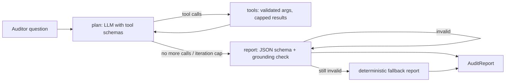

# Audit Copilot: an LLM agent for journal-entry testing on French FEC ledgers

[](https://github.com/nmc2112/audit-copilot/actions/workflows/ci.yml)

An auditor asks a question in plain language ("Are there weekend postings or round-amount entries?").
A **LangGraph** agent decides which audit tests to run, calls them through **tool calling**, and returns a
**structured, grounded report** that cites the exact `EcritureNum` values behind each finding.

The input is a **FEC** (*Fichier des Écritures Comptables*), the standard ledger export French companies
provide to auditors and the tax administration.

> All data in this repository is **synthetic**. The generator injects known anomalies so the agent can be
> evaluated with precision and recall. Findings are leads for an auditor, not conclusions.

## Live demo

**https://audit-copilot-951530503557.europe-west9.run.app** (Swagger UI). Open `POST /analyze`, type a question, leave the file empty to use the bundled synthetic FEC, and execute. Typical run: 7 tools in one round, a schema-valid report on the first attempt, about 20 s.

Deployed by CD on every green CI run on `main`: GitHub Actions → Artifact Registry → Cloud Run (Paris), authenticated with Workload Identity Federation (no stored key). The cloud configuration uses the Gemini API free tier (`gemini-3.5-flash-lite`, fallback `gemini-3.8-flash`), a per-IP rate limit and at most one instance. See [deploy/DEPLOY.md](deploy/DEPLOY.md).

## Architecture



| Component | File | Role |
|---|---|---|
| FEC loader | `src/audit_copilot/fec.py` | 18 mandatory columns, `YYYYMMDD` dates, decimal comma, tab or pipe separator |
| Audit tools | `src/audit_copilot/tools.py` | 7 deterministic tests exposed as OpenAI-style tool schemas generated from Pydantic models |
| LLM clients | `src/audit_copilot/llm.py` | Any OpenAI-compatible API (Ollama, Mistral, OpenAI…), retries with exponential backoff, model fallback |
| Orchestration | `src/audit_copilot/agent.py` | LangGraph state machine: plan → tools → plan … → report |
| Config | `config/settings.yaml`, `prompts/v1/` | Models, limits, enabled tools (feature flags) and versioned prompts |
| API | `src/audit_copilot/api.py` | FastAPI: `POST /analyze` (FEC upload + question), `GET /health` |
| Evaluation | `evals/` | Question set, ground truth from the generator, metrics, CI gate |

### Audit tools

| Tool | Classic journal-entry test |
|---|---|
| `ledger_summary` | Period, entries per journal, total debit and credit |
| `weekend_entries` | Entries posted on Saturday or Sunday |
| `round_amounts` | Large amounts that are multiples of a round value |
| `duplicate_entries` | Same piece, date, amount and journal |
| `unbalanced_entries` | Total debit different from total credit |
| `late_validation` | Validation date long after the accounting date |
| `benford_test` | First-digit Benford test with Nigrini's MAD conformity levels |

## Reliability guards

- **Tool calling with validated arguments**: tool inputs are Pydantic models; invalid or unknown calls are
  returned to the model as errors instead of crashing the run.
- **Bounded loop**: at most `max_iterations` tool-calling rounds.
- **Structured output**: the final answer must validate against the `AuditReport` schema; on failure the
  error is sent back and the model retries (`report_max_attempts`).
- **Grounding check (anti-hallucination)**: a report is rejected if it cites an entry or a tool that never
  appeared in a tool result.
- **Graceful degradation**: if the model never produces a valid report, a deterministic report is built from
  the tool results.
- **Retries and fallback**: transient HTTP errors (429, 5xx, timeouts) are retried with exponential backoff;
  the next configured model takes over if one keeps failing.
- **Token control**: tool results are capped (`max_items_per_tool`), so the model never receives the full ledger.
- **Observability**: every step is logged as JSON with node, tool, model, tokens and latency; runs return the
  full trace.

## Quick start

```bash
python -m venv .venv && source .venv/bin/activate
pip install -e ".[dev]"

# 1. Generate a synthetic ledger with injected anomalies
python -m audit_copilot.synth --out data/sample_fec.txt

# 2. Start a local model (https://ollama.com) that supports tool calling
ollama pull qwen2.5:7b

# 3. Ask a question
python -m audit_copilot.cli "Find weekend postings and round-amount entries" --fec data/sample_fec.txt -v
```

To use a hosted model as fallback, set `MISTRAL_API_KEY` (see `config/settings.yaml`).

### API

```bash
uvicorn audit_copilot.api:create_app --factory --port 8080
curl -F "question=Any duplicate invoices?" -F "fec=@data/sample_fec.txt" localhost:8080/analyze
```

### Docker

```bash
docker build -t audit-copilot .
docker run -p 8080:8080 audit-copilot
```

## Evaluation

```bash
python evals/run_eval.py              # real model from config/settings.yaml
python evals/run_eval.py --oracle     # scripted model: checks the harness, no network
```

Metrics: **tool-selection accuracy**, **anomaly recall and precision** against the injected ground truth,
**share of reports that pass schema and grounding checks**, average **latency** and **tokens** per question.
Results are written to `evals/results/`.

The `--oracle` mode does **not** measure model quality; it checks that the graph, tools, grounding and
metrics work end to end, and runs as a gate in CI. Model results:

| Model | Tool selection | Anomaly recall | Anomaly precision | Valid reports | Avg latency | Avg tokens |
|---|---|---|---|---|---|---|
| *(run `python evals/run_eval.py` and add your numbers here)* | | | | | | |

## Tests and CI

```bash
ruff check . && mypy src && pytest -v
```

29 tests run without any network access, using a scripted `FakeLLM`: retries and fallback (mocked HTTP),
invalid tool arguments, unknown tools, hallucinated citations, schema failures, the iteration cap, the API
end to end. GitHub Actions runs lint, type checks, tests, the eval gate and a Docker build with a health check.

## Limitations and next steps

- Synthetic data only; real FEC files contain more journals, multi-line entries and edge cases.
- Rule thresholds (round multiple, validation delay) are defaults, not audit standards.
- Next: Langfuse/OpenTelemetry tracing, RAG over accounting references with citations, caching and
  model routing for cost control, deployment on Cloud Run.
